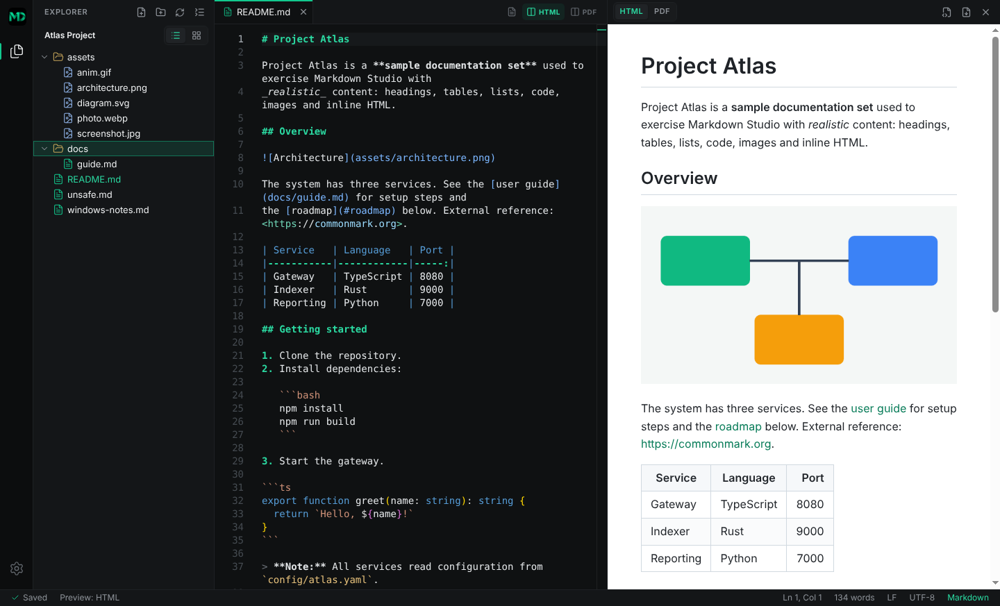

<p align="center">
  
</p>

<h1 align="center">Markdown Studio</h1>

<p align="center">
  A dedicated Markdown editor: write with assistance, preview live, export a finished PDF.
</p>

Markdown Studio is a desktop editor for Markdown documents, built for writing reports, research documents and
documentation. You edit plain Markdown source in a VS Code-style window — activity bar and Explorer on the left,
editor in the middle, live preview on the right — and export the result as a PDF or a standalone web page. It is
not a rich-text editor: the Markdown file is always the source of truth, and appearance never changes your text.



## Who it is for

Students writing school and research documents, technical writers and developers documenting software, and
anyone who wants a finished-looking PDF from plain text without Word or LaTeX. It works offline and needs no
account.

## What it does

- **Markdown editing.** Toolbar, menus and standard shortcuts (<kbd>Ctrl</kbd>+<kbd>B</kbd> bold,
  <kbd>Ctrl</kbd>+<kbd>I</kbd> italic, <kbd>Ctrl</kbd>+<kbd>K</kbd> link, <kbd>Ctrl</kbd>+<kbd>Shift</kbd>+<kbd>7</kbd>/<kbd>8</kbd>/<kbd>9</kbd>
  lists and quote); smart lists; context-aware suggestions and slash commands; an outline and table-of-contents
  generator; templates (research report, Dutch _onderzoeksverslag_, Health UI research, two-column article).
  → [Authoring guide](docs/AUTHORING.md), [shortcuts](docs/KEYBOARD_SHORTCUTS.md)
- **Problems and Quick Fixes.** Link, image, table and style checks, with fixes on <kbd>Ctrl</kbd>+<kbd>.</kbd>:
  repeated spaces, heading and list spacing, skipped heading levels, mismatched tables. Nothing is rewritten
  until you choose it. → [Tables and Quick Fixes](docs/TABLES_AND_QUICK_FIXES.md)
- **Tables.** Insert, edit visually, format (aligned, and balanced to a readable source width) and repair.
- **Images and assets.** Drag from the Explorer or your file manager, or paste a screenshot; images go in their own
  block below the text, files from outside the project are copied into `assets`, paths are relative, and renaming
  or moving files in the Explorer offers to update references. → [Images and assets](docs/IMAGES_AND_ASSETS.md)
- **Live HTML and PDF preview**, from the same renderer as the export. Mathematics (KaTeX) and Mermaid diagrams.
- **Document appearances.** Minimal, Technical, Editorial and Professional Report, customisable, plus custom CSS
  and export presets. Professional Report numbers headings automatically and respects numbers you typed.
  → [Publishing guide](docs/PUBLISHING.md)
- **PDF and HTML export** with page size, margins, headers, footers and page numbers; figures, captions,
  cross-references, citations (APA 7th edition) and multi-chapter publications. → [Writing publications](docs/PUBLICATIONS.md)
- **Safe by design.** Crash recovery of unsaved text, restored sessions, no silent overwrites of files changed
  elsewhere, atomic writes; sanitised HTML; no scripts in previews.
- **Application.** Integrated title bar, full-page Settings with search, thumbnail Explorer, command palette.
- **Optional AI assistance** (off by default): continue writing and rewrite a selection through an
  OpenAI-compatible provider, including a model on your own computer. GitHub Copilot is **not** supported.
  → [AI guide](docs/AI.md)

The complete list is in the [feature reference](docs/FEATURES.md); known limits are at its end.

## Platforms

Windows 10/11 is the primary target. macOS and Linux builds are configured and built by CI. The automated test
suites run on Linux and, in CI, on Windows; **nobody has yet playtested the application by hand on Windows or
macOS**, so expect rough edges there, especially around window controls and drag-and-drop from the file manager.
The Windows installer is not code-signed, so SmartScreen warns on first launch.

## Install and run

Requirements: [Node.js](https://nodejs.org/) 22 or newer and npm.

```bash
git clone https://github.com/FarmaanFJM/markdown-studio.git
cd markdown-studio
npm ci          # also downloads the Electron runtime
npm run dev     # starts the app with hot reload
```

`npm run build` compiles to `out/` and `npm start` runs it. Installers are built by CI (GitHub Actions
artifacts); building one yourself is described in the [development guide](docs/DEVELOPMENT.md).

New to the application? Follow the [Getting started guide](docs/GETTING_STARTED.md).

## Testing and CI

```bash
npm run lint && npm run format:check && npm run typecheck
npm run test:unit                       # Vitest
npm run build && npm run test:e2e       # Playwright drives the real Electron app (xvfb-run on Linux)
```

CI (`.github/workflows/ci.yml`) runs on every push: lint, formatting, typecheck, unit tests and the E2E suites on
Linux, the E2E suite plus the installer on Windows, and a packaged-app smoke test on Linux and macOS. See the
Actions tab for the current result of a commit; this README does not state one. Details:
[development guide](docs/DEVELOPMENT.md).

## Settings and privacy

Settings are JSON in the application data folder (`%APPDATA%\Markdown Studio` on Windows,
`~/Library/Application Support/Markdown Studio` on macOS, `~/.config/Markdown Studio` on Linux) and never contain
document content. There is no account and no telemetry, and the application makes no network connection unless you
turn on AI help; an AI provider key is encrypted by the operating system and kept in a separate file.

## Documentation

| Guide                                                                                                                                              |                                                   |
| -------------------------------------------------------------------------------------------------------------------------------------------------- | ------------------------------------------------- |
| [Getting started](docs/GETTING_STARTED.md)                                                                                                         | From an empty folder to a finished PDF            |
| [Authoring guide](docs/AUTHORING.md)                                                                                                               | Markdown syntax and the editing tools             |
| [Keyboard shortcuts](docs/KEYBOARD_SHORTCUTS.md)                                                                                                   | Windows/Linux and macOS                           |
| [Tables and Quick Fixes](docs/TABLES_AND_QUICK_FIXES.md)                                                                                           | Formatting, repair, source width                  |
| [Images and assets](docs/IMAGES_AND_ASSETS.md)                                                                                                     | Drops, paths, exports                             |
| [Publishing guide](docs/PUBLISHING.md)                                                                                                             | Appearances, heading numbers, PDF and HTML export |
| [Writing publications](docs/PUBLICATIONS.md)                                                                                                       | Captions, references, citations, chapters         |
| [Mathematics](docs/MATHEMATICS.md)                                                                                                                 | Equations and what is not supported               |
| [AI assistance](docs/AI.md)                                                                                                                        | Setup, privacy, what is and is not implemented    |
| [Feature reference](docs/FEATURES.md)                                                                                                              | Everything implemented, and known limitations     |
| [Development guide](docs/DEVELOPMENT.md), [Architecture](docs/ARCHITECTURE.md), [Releasing](docs/RELEASING.md), [Performance](docs/PERFORMANCE.md) | For contributors                                  |
| [Roadmap](docs/ROADMAP.md), [status of Levels 1 and 2](docs/LEVEL_1_2_STATUS.md), [Changelog](CHANGELOG.md)                                        | What exists and what is planned                   |

## License

Markdown Studio is released under the [MIT License](LICENSE). Bundled open-source packages and
their licenses are listed in [THIRD_PARTY_NOTICES.md](THIRD_PARTY_NOTICES.md) (regenerate with
`npm run notices`); Electron and Chromium notices ship with the application.
