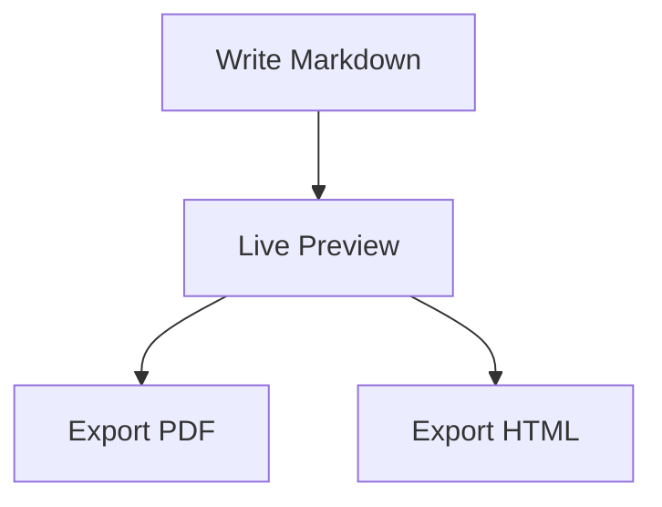

# Authoring guide

This guide explains the Markdown syntax Markdown Studio understands and the editing tools that help
you write it. Everything works on the real Markdown source: there is no second document format, and
the tools only ever change the text you point them at. Every tool is also in the command palette
(<kbd>Ctrl</kbd>+<kbd>Shift</kbd>+<kbd>P</kbd>); shortcuts are listed in
[KEYBOARD_SHORTCUTS.md](KEYBOARD_SHORTCUTS.md). New to the application? Start with
[GETTING_STARTED.md](GETTING_STARTED.md).

## Markdown syntax

Markdown is plain text with a few symbols that say how it should look. The preview, the PDF and the HTML
export all use the same renderer (markdown-it), which follows **CommonMark** plus the **GitHub Flavored
Markdown** (GFM) extensions listed below. Each example shows the source you type.

| Element              | You type                                                           | You get                                                                                                   |
| -------------------- | ------------------------------------------------------------------ | --------------------------------------------------------------------------------------------------------- |
| Heading              | `# Title`, `## Section`, `### Subsection` (up to `######`)         | Headings of level 1–6. Leave a space after the `#`s.                                                      |
| Paragraph            | Text, then a blank line                                            | A paragraph. A single line break stays inside the paragraph; end a line with two spaces for a hard break. |
| Bold                 | `**important**`                                                    | **important**                                                                                             |
| Italic               | `*important*` or `_important_`                                     | _important_                                                                                               |
| Bold and italic      | `***important***`                                                  | **_important_**                                                                                           |
| Strikethrough (GFM)  | `~~old~~`                                                          | ~~old~~                                                                                                   |
| Inline code          | `` `npm run build` ``                                              | `npm run build`                                                                                           |
| Link                 | `[Markdown Studio](https://github.com/FarmaanFJM/markdown-studio)` | A link. Local files: `[guide](docs/guide.md)`, headings: `[see below](#installatie)`                      |
| Automatic link (GFM) | `https://example.com`                                              | A clickable address                                                                                       |
| Image                | ``                                    | An image; the alt text describes it. See [IMAGES_AND_ASSETS.md](IMAGES_AND_ASSETS.md)                     |
| Bulleted list        | `- item` (also `*` or `+`)                                         | A list; indent two or four spaces to nest                                                                 |
| Numbered list        | `1. first` then `2. second`                                        | A numbered list                                                                                           |
| Task list (GFM)      | `- [ ] todo` and `- [x] done`                                      | Checkboxes                                                                                                |
| Blockquote           | `> quoted text`                                                    | An indented quote                                                                                         |
| Horizontal rule      | `---` on its own line                                              | A divider                                                                                                 |
| Table (GFM)          | `\| a \| b \|` with a `---` line under the header                  | A table; see [TABLES_AND_QUICK_FIXES.md](TABLES_AND_QUICK_FIXES.md)                                       |

**Code blocks** are fenced with three backticks, followed by the language for highlighting:

````markdown
```python
print("Hallo wereld")
```
````

**Raw HTML** is allowed in Markdown and shown in the preview and exports after sanitising: scripts, frames,
forms and event handlers are removed. Use it sparingly — it is a convenience, not part of Markdown proper.

**Mathematics** (an extension, KaTeX): `$e^{i\pi} + 1 = 0$` inline, `$$ … $$` for display equations. See the
[Mathematics guide](MATHEMATICS.md). **Diagrams** (an extension, Mermaid) are fenced blocks tagged `mermaid`.

**Markdown Studio extensions** (they are plain Markdown to other programs, and documented in
[PUBLICATIONS.md](PUBLICATIONS.md)): YAML front matter between `---` lines at the top of a file for page, theme and
numbering settings; figure and table captions with `{#fig-name}` / `{#tbl-name}` and cross-references like
`@fig-name`; citations `[@key]` with an APA reference list; `[TOC]`, `[LOF]` and `[LOT]` generated lists; and
`<!-- pagebreak -->` for a new PDF page.

**Not supported:** footnotes, definition lists, superscript/subscript syntax, merged table cells and emoji
shortcodes. They are shown as typed.

**Headings and numbers.** A heading may carry its own number (`## 1. Inleiding`, `### 4.1 Opzet`). Themes
and the section-numbering option that add numbers automatically recognise these and do not add them a second
time; see [PUBLISHING.md](PUBLISHING.md#heading-numbers).

## Suggestions and slash commands

<kbd>Ctrl</kbd>+<kbd>Space</kbd> offers suggestions for where the cursor is:

| Cursor is…                                 | Suggestions                                                                                                                                                                      |
| ------------------------------------------ | -------------------------------------------------------------------------------------------------------------------------------------------------------------------------------- |
| At the start of a line                     | Headings, lists, task list, quote, code block, rule, table, collapsible section, document sections (Installation, Usage, Contributing, License, Changelog entry), saved snippets |
| Inside a line                              | Bold, italic, strikethrough, inline code, link, image, saved snippets                                                                                                            |
| In a table                                 | Format table, insert row, insert column, edit table visually, then inline items                                                                                                  |
| After ` ``` ` at the start of a code block | Language names                                                                                                                                                                   |
| Inside `](…)` of a link or image           | Files and folders relative to the document; for images only image files                                                                                                          |
| After `#` in a link                        | Headings of this document (`#…`) or of the linked file (`file.md#…`)                                                                                                             |
| Inside a code block                        | Nothing                                                                                                                                                                          |

Each entry shows what it will insert. Accept with <kbd>Enter</kbd> or <kbd>Tab</kbd>, move with
the arrow keys, dismiss with <kbd>Esc</kbd>. After a snippet, <kbd>Tab</kbd> jumps through its
placeholders: a link becomes `[link text](url)` with the text selected, an image
``, a code block puts the cursor inside it.

Typing `/` on an empty line that follows a blank line opens a small menu that narrows as you
type (`/tab`, `/code`, `/h2`…). A `/` inside a sentence, a path or a URL never does. With
**Automatic suggestions** off in Settings, only <kbd>Ctrl</kbd>+<kbd>Space</kbd> shows suggestions.

Path suggestions use the same rules as the preview and as image drag-and-drop: they are
relative to the document's folder (or the workspace root for a path starting with `/`), file
names with spaces or parentheses are written as `<assets/My Photo (1).png>`, and `%` is
encoded. With nothing typed yet, images (or Markdown files, for links) elsewhere in the
workspace are listed with the relative path that reaches them.

## Formatting

| Command                         | Selected text                                                                               | Nothing selected                                                                     | Applied again                                       |
| ------------------------------- | ------------------------------------------------------------------------------------------- | ------------------------------------------------------------------------------------ | --------------------------------------------------- |
| Bold, italic, strike, code      | Wrapped; each line of a multi-line selection separately                                     | Inside a word, that word; otherwise an empty pair with the cursor between its halves | Removed                                             |
| Heading 1–6, Paragraph          | Every non-blank selected line                                                               | The current line                                                                     | Same level → paragraph                              |
| Bulleted / numbered / task list | Each non-blank line (numbered lists count per nesting level and restart after a blank line) | Current line                                                                         | Back to plain lines; other list types are converted |
| Blockquote                      | Quoted (blank lines between quoted lines keep the quote together)                           | Current line                                                                         | Unquoted                                            |
| Link                            | `[selection](url)`, or `[text](selected URL)` when a URL is selected                        | `[link text](url)`                                                                   | —                                                   |
| Image                           | `` (the selection becomes the alt text)                                   | ``                                                                  | —                                                   |
| Code block                      | The selected lines are fenced                                                               | An empty fence with the cursor inside                                                | —                                                   |

Rules that hold for all of them: they are one undo step; unrelated lines stay byte-for-byte as
they were; line endings (LF/CRLF) and the byte-order mark are untouched; they do nothing inside
code blocks (a message says so); with several cursors, every cursor is handled.

Italic never mistakes bold for italic: on `**word**` it produces `***word***`, and on
`***word***` it removes only the italic layer.

### Lists and quotes

- <kbd>Enter</kbd> at the end of `- item`, `1. item`, `- [x] task` or `> quote` starts the next
  item (`- `, `2. `, `- [ ] `, `> `). Lists numbered `1. 1. 1.` keep that style.
- <kbd>Enter</kbd> on an empty item ends the list; on an empty nested item it moves the item
  one level out.
- <kbd>Tab</kbd> nests the item under the previous one, <kbd>Shift</kbd>+<kbd>Tab</kbd> moves
  it out; the lines nested below it move with it.
- Inside code blocks, and with **Smart lists and quotes** off, <kbd>Enter</kbd> and
  <kbd>Tab</kbd> behave as in any text editor.

## Tables

Writing, formatting and repairing tables — including the _Table source width_ setting for wide tables, the
visual table editor and Tab navigation between cells — is covered in
[TABLES_AND_QUICK_FIXES.md](TABLES_AND_QUICK_FIXES.md).

## Links, images and problems

The editor underlines, and the status bar counts:

- **Warnings** — a linked file or image that does not exist, a heading anchor that does not
  exist in this document or in the linked Markdown file, a table that the preview would not
  show as written. References are resolved exactly as the preview does. Web addresses, mail
  links and folders that exist are fine, and links inside code or HTML comments are ignored.
- **Notes** — spacing and structure from markdownlint (multiple blank lines, missing blank
  lines around lists and headings, trailing spaces, inconsistent list markers, empty links…).
  Rules that clash with Markdown Studio (line length, inline HTML, bare URLs, first-line
  heading, link fragments) are off. Switch single rules off in **Settings → Markdown**.

Click the status-bar counter or press <kbd>F8</kbd> to step through them. The quick-fix menu
(<kbd>Ctrl</kbd>+<kbd>.</kbd>, or the lightbulb) offers a correction only when it is unambiguous: remove
repeated spaces, normalise heading and list spacing, change a skipped heading level, repair a table with
mismatched columns, a moved file with a unique name, an anchor with one obvious spelling.
_Format Markdown Block_ tidies the block under the cursor, and _Fix All Automatic Style Problems_ applies
markdownlint's own fixes in one undoable edit. The full list is in
[TABLES_AND_QUICK_FIXES.md](TABLES_AND_QUICK_FIXES.md#quick-fixes). Nothing is ever rewritten just because a
warning is shown.

## Renaming and moving

In the Explorer, **Rename…** (F2), **Move…** (a folder picker) and dragging a file or folder
onto a folder keep the Markdown that refers to it working. Before anything changes you see the
documents and the number of references affected, and choose _Rename/Move and Update
References_, _Without Updating_ or _Cancel_.

- References are found with the Markdown parser, not by searching for the file name: links,
  images, reference definitions and `` / `<a href>`; code blocks, code spans and web
  addresses are not touched. Fragments (`#section`), queries and the written style (`<…>`,
  `%20`, `/root-relative`) are kept.
- When a Markdown file moves, its own relative links are recalculated; links between files that
  move together stay as they are.
- A document that is open is updated in its editor (undoable). If it has unsaved changes, the
  update stays unsaved too, so nothing you have not saved reaches the disk. Files that are not
  open are written only if they are unchanged since they were scanned; otherwise they are
  reported and left alone.
- If some references cannot be updated, a list says which, instead of reporting success.

## Settings

| Setting                            | Effect                                                                      |
| ---------------------------------- | --------------------------------------------------------------------------- |
| Smart lists and quotes             | Enter continues lists and quotes; Tab / Shift+Tab nest items                |
| Table navigation                   | Tab / Shift+Tab move between cells and tidy the table                       |
| Automatic suggestions              | Trigger suggestions after `/` and in link paths (Ctrl+Space always works)   |
| Formatting toolbar                 | Show the toolbar above the editor (also _View → Toggle Formatting Toolbar_) |
| Check links and images             | Missing files, images and anchors                                           |
| Check tables                       | Tables the preview does not show as written                                 |
| Style checks / Style rules         | markdownlint notes, and which rules are on                                  |
| Include the document title / depth | Table-of-contents contents                                                  |
| Author name                        | Offered when a template asks for an author                                  |
| Table source width                 | Target line width of Format Table (0 = always align fully)                  |

## Mathematics, diagrams and page breaks (Phase 3)

Mathematics uses `$…$` for inline and `$$…$$` for display equations; the
[Mathematics guide](MATHEMATICS.md) has a cookbook (fractions, integrals, matrices, piecewise and
aligned equations), manual numbering with `\tag{…}`, and the exact limits compared with LaTeX.

```markdown
Euler's identity is $e^{i\pi} + 1 = 0$, and a price like $5 or $10 stays text.

$$
\int_{0}^{\infty} e^{-x^2}\,dx = \frac{\sqrt{\pi}}{2} \tag{1}
$$
```

Diagrams are fenced blocks tagged `mermaid`. Type ` ```mermaid ` and press <kbd>Ctrl</kbd>+<kbd>Space</kbd>
inside the empty block for starters (flowchart, sequence, class, state, ER, Gantt, pie), or insert
one from **Insert → Mermaid Flowchart**:

````markdown

````

A malformed diagram or equation never breaks the rest of the document: the preview shows what is
wrong (click it to jump to the source), and the same problem appears in the editor's problem list
(<kbd>F8</kbd>).

A line containing only `<!-- pagebreak -->` starts a new page in the PDF (**Insert → Page
Break**). Themes, custom CSS, page setup, headers, footers and export presets are covered in the
[Publishing guide](PUBLISHING.md).

Slash commands now include `/equation`, `/mermaid` and `/page`.

## Captions, references, citations and chapters (Levels 1 and 2)

Figures and tables with automatic numbers, cross-references, citations with an APA reference
list, document settings (page, columns, contents), templates for research reports and Health UI
research, and publications that combine several chapters are described in
[Writing publications](PUBLICATIONS.md). New commands there: **Insert → Figure with Caption…**
(Ctrl+Shift+F), **Cross-reference…** (Ctrl+Shift+R), **Citation…** (Ctrl+Shift+C), **Publish →
Document Settings…** (Ctrl+Shift+D), **Manage Sources…**, and the **Publication** panel
(Ctrl+Shift+J). Typing `@` suggests labels and source keys. The heading, list and quote buttons
insert their marker on an empty line, **Insert Table** asks for rows and columns, and pasting an
image saves it in the project.
