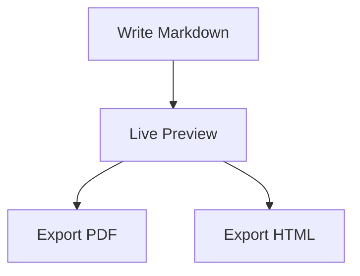

# Authoring guide

This guide describes the Markdown authoring tools of Markdown Studio (Phase 2). Everything works
on the real Markdown source: there is no second document format, and the tools only ever change
the text you point them at. Every tool is also in the command palette
(<kbd>Ctrl</kbd>+<kbd>Shift</kbd>+<kbd>P</kbd>); shortcuts are listed in the
[README](../README.md#keyboard-shortcuts).

## Suggestions and slash commands

<kbd>Ctrl</kbd>+<kbd>Space</kbd> offers suggestions for where the cursor is:

| Cursor is…                                 | Suggestions                                                                                                                                                                      |
| ------------------------------------------ | -------------------------------------------------------------------------------------------------------------------------------------------------------------------------------- |
| At the start of a line                     | Headings, lists, task list, quote, code block, rule, table, collapsible section, document sections (Installation, Usage, Contributing, License, Changelog entry), saved snippets |
| Inside a line                              | Bold, italic, strikethrough, inline code, link, image, saved snippets                                                                                                            |
| In a table                                 | Format table, insert row, insert column, edit table visually, then inline items                                                                                                  |
| After ` ``` ` at the start of a code block | Language names                                                                                                                                                                   |
| Inside `](…)` of a link or image           | Files and folders relative to the document; for images only image files                                                                                                          |
| After `#` in a link                        | Headings of this document (`#…`) or of the linked file (`file.md#…`)                                                                                                             |
| Inside a code block                        | Nothing                                                                                                                                                                          |

Each entry shows what it will insert. Accept with <kbd>Enter</kbd> or <kbd>Tab</kbd>, move with
the arrow keys, dismiss with <kbd>Esc</kbd>. After a snippet, <kbd>Tab</kbd> jumps through its
placeholders: a link becomes `[link text](url)` with the text selected, an image
``, a code block puts the cursor inside it.

Typing `/` on an empty line that follows a blank line opens a small menu that narrows as you
type (`/tab`, `/code`, `/h2`…). A `/` inside a sentence, a path or a URL never does. With
**Automatic suggestions** off in Settings, only <kbd>Ctrl</kbd>+<kbd>Space</kbd> shows suggestions.

Path suggestions use the same rules as the preview and as image drag-and-drop: they are
relative to the document's folder (or the workspace root for a path starting with `/`), file
names with spaces or parentheses are written as `<assets/My Photo (1).png>`, and `%` is
encoded. With nothing typed yet, images (or Markdown files, for links) elsewhere in the
workspace are listed with the relative path that reaches them.

## Formatting

| Command                         | Selected text                                                                               | Nothing selected                                           | Applied again                                       |
| ------------------------------- | ------------------------------------------------------------------------------------------- | ---------------------------------------------------------- | --------------------------------------------------- |
| Bold, italic, strike, code      | Wrapped; each line of a multi-line selection separately                                     | The word at the cursor, or an empty pair around the cursor | Removed                                             |
| Heading 1–6, Paragraph          | Every non-blank selected line                                                               | The current line                                           | Same level → paragraph                              |
| Bulleted / numbered / task list | Each non-blank line (numbered lists count per nesting level and restart after a blank line) | Current line                                               | Back to plain lines; other list types are converted |
| Blockquote                      | Quoted (blank lines between quoted lines keep the quote together)                           | Current line                                               | Unquoted                                            |
| Link                            | `[selection](url)`, or `[text](selected URL)` when a URL is selected                        | `[link text](url)`                                         | —                                                   |
| Image                           | `` (the selection becomes the alt text)                                   | ``                                        | —                                                   |
| Code block                      | The selected lines are fenced                                                               | An empty fence with the cursor inside                      | —                                                   |

Rules that hold for all of them: they are one undo step; unrelated lines stay byte-for-byte as
they were; line endings (LF/CRLF) and the byte-order mark are untouched; they do nothing inside
code blocks (a message says so); with several cursors, every cursor is handled.

Italic never mistakes bold for italic: on `**word**` it produces `***word***`, and on
`***word***` it removes only the italic layer.

### Lists and quotes

- <kbd>Enter</kbd> at the end of `- item`, `1. item`, `- [x] task` or `> quote` starts the next
  item (`- `, `2. `, `- [ ] `, `> `). Lists numbered `1. 1. 1.` keep that style.
- <kbd>Enter</kbd> on an empty item ends the list; on an empty nested item it moves the item
  one level out.
- <kbd>Tab</kbd> nests the item under the previous one, <kbd>Shift</kbd>+<kbd>Tab</kbd> moves
  it out; the lines nested below it move with it.
- Inside code blocks, and with **Smart lists and quotes** off, <kbd>Enter</kbd> and
  <kbd>Tab</kbd> behave as in any text editor.

## Tables

Given

```markdown
| Name  | Age | City      |
| ----- | --- | --------- |
| Alice | 24  | Amsterdam |
| Bob   | 30  | Rotterdam |
```

**Format Table** (<kbd>Alt</kbd>+<kbd>Shift</kbd>+<kbd>F</kbd>) produces

```markdown
| Name  | Age | City      |
| ----- | --- | --------- |
| Alice | 24  | Amsterdam |
| Bob   | 30  | Rotterdam |
```

- Alignment markers (`:--`, `:-:`, `--:`) are kept and the cells are padded to match.
- Cells keep their text exactly, including escaped pipes (`\|`), inline Markdown, and empty
  cells. Rows with too few cells are completed. Columns are measured by display width, so CJK
  text and emoji line up.
- _Format Tables in Selection_ and _Format All Tables_ do the same for several tables. Text
  between tables and tables inside code blocks are never touched.
- A table is not rewritten when that would lose content (a row with non-empty cells beyond the
  header's columns), or when it begins on a list-item marker line; a message explains why.
- Inside a table, <kbd>Tab</kbd> moves to the next cell (tidying the table first), at the very
  last cell it adds a row, and <kbd>Shift</kbd>+<kbd>Tab</kbd> moves back. The _Table_ menu and
  palette have commands to insert or delete rows and columns and to set a column's alignment.

### The table editor

_Edit Table Visually…_ (<kbd>Alt</kbd>+<kbd>Shift</kbd>+<kbd>T</kbd>) opens the table under the
cursor as a grid. Edit cells and headers, use the toolbar for rows and columns (relative to
the cell you are in), and the three alignment buttons above each column. _Apply to Document_
(<kbd>Ctrl</kbd>+<kbd>Enter</kbd>) replaces exactly that table with well-formed GFM in one
undoable edit; _Cancel_ or <kbd>Esc</kbd> leaves the document untouched. If the table is
changed in the document while the grid is open (or text is added to its edge), a notice appears
and _Apply_ is disabled until you choose _Reload from document_.

_Insert Table…_ (<kbd>Ctrl</kbd>+<kbd>Shift</kbd>+<kbd>T</kbd>) designs a new table the same way
and inserts it at the cursor.

## Templates and snippets

_File → New File from Template…_ (<kbd>Ctrl</kbd>+<kbd>Shift</kbd>+<kbd>N</kbd>) lists the
templates: those of the open folder, your global ones, and the built-in ones (README, Technical
documentation, Project notes, Meeting notes, Report, Blank document). Choose one and enter the
values it needs.

| Placeholder    | Replaced by                                                                                                                                           |
| -------------- | ----------------------------------------------------------------------------------------------------------------------------------------------------- |
| `{{title}}`    | The title you type (also suggests the file name)                                                                                                      |
| `{{date}}`     | Today, `YYYY-MM-DD`                                                                                                                                   |
| `{{datetime}}` | Today and the current time, `YYYY-MM-DD HH:mm` (local time)                                                                                           |
| `{{author}}`   | The name you type. It is offered again next time (Settings → Author name) but never filled in without you; empty is allowed and leaves no stray space |
| `{{cursor}}`   | Nothing: the cursor starts there                                                                                                                      |

Write `\{{title}}` for the literal text. Unknown names such as `{{foo}}` stay as they are, and
replaced values are never expanded again. Templates are text; nothing in them is run.

- With a folder open the document is created in the folder selected in the Explorer, with a
  file name you can change. An existing file is never overwritten (you are told, and can choose
  another name); cancelling creates nothing. Without a folder, an unsaved document is created
  and _Save As_ asks where to put it. A contents block (the managed markers below) in a
  template is filled in.
- **Save Document as Template…** and **Save Selection as Snippet or Template…** keep the
  content. Choose its name, description, type (_Document template_ creates files; _Snippet_ is
  inserted at the cursor) and where it is available: **This folder only** (stored in
  `<folder>/.markdown-studio/templates/`, hidden in the Explorer and moves with the project)
  or **All folders** (stored in the application's data folder).
- **Manage Templates and Snippets…** browses, edits, renames (edit the name), duplicates (also
  built-in ones, as your own copy) and deletes (with confirmation).
- **Local files.** A template cannot carry files. When you save one that refers to local images
  or documents, you choose between _Make paths workspace-relative_ (references become
  `/assets/logo.png` and are re-pointed for each new document, wherever in the folder it is
  created) and _Keep as written_. When you create a document, references whose files do not
  exist at its location are listed first so you can decide.
- Saved snippets (type _Snippet_) are inserted with **Insert Saved Snippet…**, the slash menu
  and the suggestion list; `{{date}}`, `{{datetime}}` are filled in, `{{title}}` is the
  document's name, `{{author}}` is your saved name, and `{{cursor}}` is where the cursor ends.

## Outline and table of contents

The **Outline** section of the Explorer lists the headings of the active document as a tree.
Click one to go to it; the heading that contains the cursor is highlighted; use the arrow keys,
<kbd>Enter</kbd>, <kbd>←</kbd>/<kbd>→</kbd> to collapse and expand. The list is built from the
same parse as the preview, so a heading in a code block is not listed and every listed heading
is a heading the preview renders.

**Insert Table of Contents** adds

```markdown
<!-- markdown-studio:toc:start -->

- [Installation](#installation)
  - [Windows](#windows)
  - [Linux](#linux)
- [Configuration](#configuration)

<!-- markdown-studio:toc:end -->
```

at the cursor (or updates the block that already exists). **Update Table of Contents**
regenerates only the lines between the two markers; a list or table of contents you wrote
yourself is never replaced. Anchors are the preview's anchors, so repeated headings become
`#usage`, `#usage-1`, `#usage-2`.

- By default the document title (a first `#` heading) is not listed; Settings → _Table of
  contents_ can include it and limit the depth.
- Add `<!-- omit in toc -->` to a heading line to leave it out. A `Table of Contents` heading
  right above the markers does not list itself.
- A start marker without an end marker is reported and nothing is changed.

## Links, images and problems

The editor underlines, and the status bar counts:

- **Warnings** — a linked file or image that does not exist, a heading anchor that does not
  exist in this document or in the linked Markdown file, a table that the preview would not
  show as written. References are resolved exactly as the preview does. Web addresses, mail
  links and folders that exist are fine, and links inside code or HTML comments are ignored.
- **Notes** — spacing and structure from markdownlint (multiple blank lines, missing blank
  lines around lists and headings, trailing spaces, inconsistent list markers, empty links…).
  Rules that clash with Markdown Studio (line length, inline HTML, bare URLs, first-line
  heading, link fragments) are off. Switch single rules off in Settings → _Problems_.

Click the status-bar counter or press <kbd>F8</kbd> to step through them. The quick-fix menu
(<kbd>Ctrl</kbd>+<kbd>.</kbd>) offers a correction only when it is unambiguous: a moved file
with a unique name, an anchor with one obvious spelling. _Fix All Automatic Style Problems_
applies markdownlint's own fixes in one undoable edit. Nothing is ever rewritten just because a
warning is shown.

## Renaming and moving

In the Explorer, **Rename…** (F2), **Move…** (a folder picker) and dragging a file or folder
onto a folder keep the Markdown that refers to it working. Before anything changes you see the
documents and the number of references affected, and choose _Rename/Move and Update
References_, _Without Updating_ or _Cancel_.

- References are found with the Markdown parser, not by searching for the file name: links,
  images, reference definitions and `` / `<a href>`; code blocks, code spans and web
  addresses are not touched. Fragments (`#section`), queries and the written style (`<…>`,
  `%20`, `/root-relative`) are kept.
- When a Markdown file moves, its own relative links are recalculated; links between files that
  move together stay as they are.
- A document that is open is updated in its editor (undoable). If it has unsaved changes, the
  update stays unsaved too, so nothing you have not saved reaches the disk. Files that are not
  open are written only if they are unchanged since they were scanned; otherwise they are
  reported and left alone.
- If some references cannot be updated, a list says which, instead of reporting success.

## Settings

| Setting                            | Effect                                                                      |
| ---------------------------------- | --------------------------------------------------------------------------- |
| Smart lists and quotes             | Enter continues lists and quotes; Tab / Shift+Tab nest items                |
| Table navigation                   | Tab / Shift+Tab move between cells and tidy the table                       |
| Automatic suggestions              | Trigger suggestions after `/` and in link paths (Ctrl+Space always works)   |
| Formatting toolbar                 | Show the toolbar above the editor (also _View → Toggle Formatting Toolbar_) |
| Check links and images             | Missing files, images and anchors                                           |
| Check tables                       | Tables the preview does not show as written                                 |
| Style checks / Style rules         | markdownlint notes, and which rules are on                                  |
| Include the document title / depth | Table-of-contents contents                                                  |
| Author name                        | Offered when a template asks for an author                                  |

## Mathematics, diagrams and page breaks (Phase 3)

Mathematics uses `$…$` for inline and `$$…$$` for display equations; the
[Mathematics guide](MATHEMATICS.md) has a cookbook (fractions, integrals, matrices, piecewise and
aligned equations), manual numbering with `\tag{…}`, and the exact limits compared with LaTeX.

```markdown
Euler's identity is $e^{i\pi} + 1 = 0$, and a price like $5 or $10 stays text.

$$
\int_{0}^{\infty} e^{-x^2}\,dx = \frac{\sqrt{\pi}}{2} \tag{1}
$$
```

Diagrams are fenced blocks tagged `mermaid`. Type ` ```mermaid ` and press <kbd>Ctrl</kbd>+<kbd>Space</kbd>
inside the empty block for starters (flowchart, sequence, class, state, ER, Gantt, pie), or insert
one from **Insert → Mermaid Flowchart**:

````markdown

````

A malformed diagram or equation never breaks the rest of the document: the preview shows what is
wrong (click it to jump to the source), and the same problem appears in the editor's problem list
(<kbd>F8</kbd>).

A line containing only `<!-- pagebreak -->` starts a new page in the PDF (**Insert → Page
Break**). Themes, custom CSS, page setup, headers, footers and export presets are covered in the
[Publishing guide](PUBLISHING.md).

Slash commands now include `/equation`, `/mermaid` and `/page`.

## Captions, references, citations and chapters (Levels 1 and 2)

Figures and tables with automatic numbers, cross-references, citations with an APA reference
list, document settings (page, columns, contents), templates for research reports and Health UI
research, and publications that combine several chapters are described in
[Writing publications](PUBLICATIONS.md). New commands there: **Insert → Figure with Caption…**
(Ctrl+Shift+F), **Cross-reference…** (Ctrl+Shift+R), **Citation…** (Ctrl+Shift+C), **Publish →
Document Settings…** (Ctrl+Shift+D), **Manage Sources…**, and the **Publication** panel
(Ctrl+Shift+J). Typing `@` suggests labels and source keys. The heading, list and quote buttons
insert their marker on an empty line, **Insert Table** asks for rows and columns, and pasting an
image saves it in the project.
