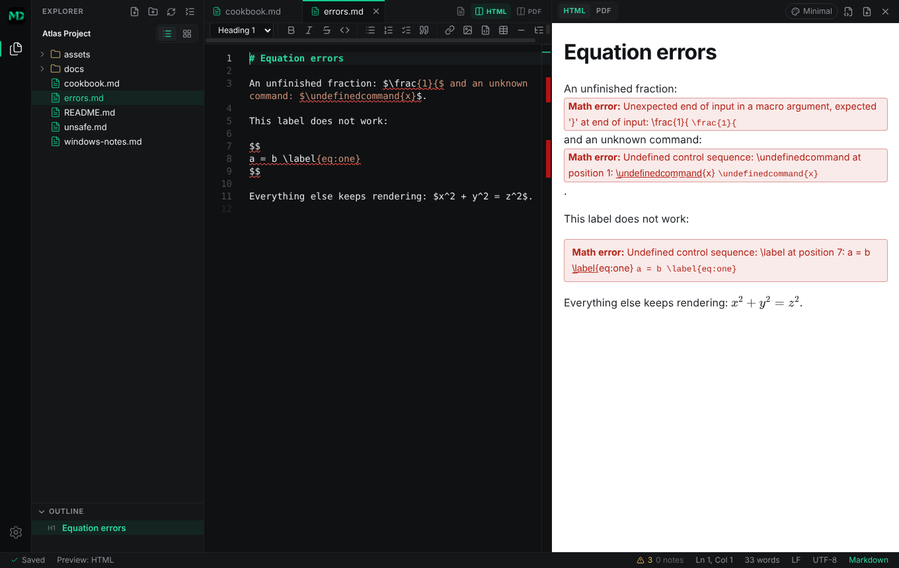

# Writing mathematics in Markdown Studio

Markdown Studio typesets mathematics with [KaTeX](https://katex.org), bundled with the
application. You write LaTeX-style notation directly in your Markdown; the text stays exactly as
you typed it, and the HTML preview, the PDF preview, standalone HTML export and PDF export all
show the same typeset result. Fonts and styles are included in the application and in every
exported file, so equations look the same offline.

> Everything in this guide has been tried in the running application. Each example below is
> rendered by an automated test (`tests/unit/mathGuide.test.ts`), and equation tags are checked in
> all four outputs by `tests/e2e/mathematics.spec.ts`. Features that are **not** implemented are
> listed in [What is not supported](#what-is-not-supported) rather than hidden.


- [Quick start](#quick-start)
- [Delimiters and what counts as math](#delimiters-and-what-counts-as-math)
- [Cookbook](#cookbook)
- [Numbering equations with `\tag`](#numbering-equations-with-tag)
- [When an equation has an error](#when-an-equation-has-an-error)
- [Settings and export](#settings-and-export)
- [KaTeX is not complete LaTeX](#katex-is-not-complete-latex)
- [What is not supported](#what-is-not-supported)

## Quick start

Insert an inline equation with **Insert → Inline Math**, a display equation with **Insert →
Display Equation** (or search "equation" in the command palette, `Ctrl+Shift+P`), or just type:

```markdown
The energy of a particle is $E = mc^2$.

$$
\int_{0}^{\infty} e^{-x^2}\,dx = \frac{\sqrt{\pi}}{2}
$$
```

Inline math (`$…$`) sits in the line of text. Display math (`$$…$$`) is centred on its own line
with extra spacing. In the editor, typing `/equation` on an empty line offers the display equation, and
`Ctrl+Space` offers both snippets.

## Delimiters and what counts as math

| Delimiter  | Kind    | Example                |
| ---------- | ------- | ---------------------- |
| `$…$`      | inline  | `$a^2 + b^2 = c^2$`    |
| `\(…\)`    | inline  | `\(a^2 + b^2 = c^2\)`  |
| `$$…$$`    | display | `$$ x = \frac{1}{2} $$` |
| `\[…\]`    | display | `\[ x = \frac{1}{2} \]` |

A display equation may be written on one line or across several; the opening and closing
`$$` may be on their own lines.

```markdown
Both forms work: \(a^2 + b^2 = c^2\) and $a^2 + b^2 = c^2$.

\[
x = \frac{-b \pm \sqrt{b^2 - 4ac}}{2a}
\]
```

### Dollar signs that are not math

The rules are deliberately conservative (they follow Pandoc's `tex_math_dollars` rules), so
ordinary prices and currency stay text:

- The opening `$` must be followed by a non-space character, and the closing `$` must be preceded
  by one and **must not be followed by a digit**. `It costs $5 and then $10 more.` is plain text.
- Write `\$` for a literal dollar sign anywhere, including inside math: `$a \$ b$`.
- Nothing inside inline code (`` `$x$` ``) or fenced code blocks is ever treated as math.
- An opening delimiter with no closing partner stays as written.

```markdown
Prices: $5 and $10 stay text. An escaped \$x\$ is text too.
Code is untouched: `$x$`. Math with a dollar inside: $a \$ b$.
```

If you want a lone `$` followed by something that looks like math, escape it (`\$`).

## Cookbook

Copy any of these into a document. Display form is shown; every one also works inline.

### Fractions, exponents, subscripts and roots

```markdown
$$
\frac{a+b}{c+d} \qquad x^{2} \qquad x_{i} \qquad x_i^2 \qquad a_{n+1}^{k} \qquad \sqrt{x} \qquad \sqrt[3]{x^2+1}
$$
```

Group with braces: `x^{10}` is _x_ to the tenth, `x^10` is _x_ to the first followed by a 0.

### Greek letters and common symbols

```markdown
$$
\alpha \beta \gamma \delta \epsilon \theta \lambda \mu \pi \sigma \phi \omega
\quad \Gamma \Delta \Theta \Lambda \Pi \Sigma \Phi \Omega
\quad \infty \partial \nabla \pm \times \cdot \leq \geq \neq \approx \in \subset \forall \exists
$$
```

### Integrals

```markdown
$$
\int_{0}^{1} x^2\,dx = \frac{1}{3}
\qquad
\oint_C \vec{F}\cdot d\vec{r}
\qquad
\iint_D f(x,y)\,dA
$$
```

### Derivatives

```markdown
$$
\frac{d}{dx}\left(x^2\right) = 2x
\qquad
\frac{\partial f}{\partial x}
\qquad
f'(x) = \lim_{h \to 0} \frac{f(x+h) - f(x)}{h}
$$
```

### Sums, products and limits

```markdown
$$
\sum_{i=1}^{n} i = \frac{n(n+1)}{2}
\qquad
\prod_{k=1}^{n} k = n!
\qquad
\lim_{x \to 0} \frac{\sin x}{x} = 1
$$
```

### Matrices and determinants

```markdown
$$
A = \begin{pmatrix} a & b \\ c & d \end{pmatrix}
\qquad
\begin{bmatrix} 1 & 0 \\ 0 & 1 \end{bmatrix}
\qquad
\begin{vmatrix} a & b \\ c & d \end{vmatrix} = ad - bc
$$
```

`pmatrix` uses parentheses, `bmatrix` square brackets, `vmatrix` bars, `Bmatrix` braces. Columns
are separated by `&` and rows by `\\`.

### Piecewise functions

```markdown
$$
f(x) =
\begin{cases}
  x^2 & \text{if } x \ge 0 \\
  -x  & \text{if } x < 0
\end{cases}
$$
```

### Multi-line aligned equations

Use `aligned` and put `&` where the lines should line up.

```markdown
$$
\begin{aligned}
(a+b)^2 &= (a+b)(a+b) \\
        &= a^2 + 2ab + b^2
\end{aligned}
$$
```

### Words, spacing and style inside math

```markdown
$$
\text{speed} = \frac{\text{distance}}{\text{time}}
\qquad
a \, b \quad c \qquad d
\qquad
\mathbf{v} \quad \mathbb{R} \quad \mathcal{L} \quad \hat{x} \quad \bar{y} \quad \boxed{E = mc^2}
$$
```

`\,` is a thin space, `\quad` and `\qquad` are wider ones; `\text{…}` sets ordinary text.

## Numbering equations with `\tag`

Markdown Studio has no document-wide automatic numbering (see below), but KaTeX supports
**manual** numbers with `\tag{…}`.
Write the number or name you want; it is placed at the right edge of the display equation,
in parentheses.

```markdown
$$
E = mc^2 \tag{1}
$$

$$
\int_{0}^{\infty} e^{-x^2}\,dx = \frac{\sqrt{\pi}}{2} \tag{Gauss}
$$

$$
a^2 + b^2 = c^2 \tag*{Pythagoras}
$$
```

`\tag*{…}` leaves out the parentheses. In a multi-line `align` environment each line can carry its own tag (`aligned`, used above for
untagged derivations, does not accept `\tag`; use `align` when you want per-line tags):

```markdown
$$
\begin{align}
a &= b + c \tag{2} \\
d &= e + f \tag{3}
\end{align}
$$
```

What has been verified (see `tests/e2e/mathematics.spec.ts`):

| Output                | `\tag{1}` shown | Notes                                    |
| --------------------- | --------------- | ---------------------------------------- |
| HTML preview          | yes             |                                          |
| PDF preview           | yes             | same Chromium print pipeline as export   |
| Standalone HTML export | yes            | no JavaScript needed                     |
| PDF export            | yes             | real, selectable text                    |


Things to know:

- `\tag` works **only in display math** (`$$…$$` or `\[…\]`). In an inline `$…$` it is reported
  as an error.
- The number is exactly what you type. Markdown Studio does not renumber, check for duplicate
  tags, or keep a list of them (see [What is not supported](#what-is-not-supported)).
- Refer to an equation in prose by typing its number: `see equation (1)`. There are no automatic
  cross-references, so if you renumber, update the text yourself.

### Numbers KaTeX adds inside one equation

The environments `equation`, `align` and `gather` number their lines **by themselves, counting from
(1) in every equation**. The counter is not shared between equations, so two separate `equation`
blocks are both numbered "(1)". For that reason, use `\tag` whenever a number has to be unique in
your document. The starred forms (`equation*`, `align*`, `gather*`) and `aligned` do not number
anything, and `\nonumber` or `\notag` leaves a single line unnumbered.

```markdown
$$
\begin{align}
a &= b + c \\
d &= e + f \nonumber \\
g &= h
\end{align}
$$
```

Here the first and third lines are numbered (1) and (2); the second is skipped.

## When an equation has an error

A problem in one equation never affects the rest of the document. In the preview and in exports,
the equation is replaced by a highlighted note that says what is wrong and shows the source:

```markdown
<!-- expect-error -->
An unfinished fraction: $\frac{1}{$ and an unknown command: $\undefinedcommand{x}$.
```



The same problems appear as errors in the editor (underlined at the equation, listed in the
status bar, reachable with **F8**). Fix the source and the preview updates.

## Settings and export

- **Settings → Mathematical Notation → Render math** turns typesetting off. The Markdown is not
  changed; equations then appear as the source text you wrote. A workspace can override this
  setting (Settings → Document Appearance → This workspace).
- Standalone HTML exports embed the KaTeX fonts and styles. They need no internet connection and no
  JavaScript.
- PDF exports contain real text and vector glyphs, and display equations are kept from splitting
  across pages.
- The document theme controls the size and colour of equations (they inherit the text colour).

## KaTeX is not complete LaTeX

KaTeX is a fast renderer for the **mathematics** of LaTeX. It is not a TeX engine. It
understands a large, well-documented set of math commands and environments
([KaTeX support table](https://katex.org/docs/supported.html)), but it does not run a document
class, load packages, or typeset a whole document. Markdown Studio uses KaTeX's own parser with
untrusted content disabled, so commands that would load resources or inject markup are not
available.

| You may know from LaTeX                       | In Markdown Studio                                        |
| --------------------------------------------- | --------------------------------------------------------- |
| `amsmath` environments (`aligned`, `cases`, `matrix` family, `gather`, `align`) | Supported by KaTeX |
| `\tag{…}`, `\tag*{…}`                         | Supported, display math only, numbers are manual           |
| `equation` / `align` / `gather` numbering     | Numbered per equation, restarting at (1); **no document-wide sequence** |
| `\label{…}`, `\ref{…}`, `\eqref{…}`           | **Not supported** (reported as an unknown command)         |
| `\newcommand`, `\renewcommand`, `\def`        | Only inside one expression; **nothing persists** (below)   |
| `\usepackage`, document classes, preamble     | **Not supported**                                          |
| `theorem`, `proof` and similar environments   | **Not supported** (write them in Markdown)                 |
| TikZ, `tabular`, floats, bibliography, indexes | **Not supported**                                         |
| `\href`, `\url`, `\includegraphics`, `\html…` | Disabled for safety; shown as unsupported text             |

## What is not supported

These capabilities are **not implemented** in Markdown Studio today. They are described as
future work in the [academic publishing roadmap](ACADEMIC_PUBLISHING_ROADMAP.md).

- **Document-wide automatic equation numbering.** Lines inside `equation`, `align` or `gather` are
  numbered from (1) within each equation, but there is no running count across the document.
  Write `\tag{…}` for numbers that must be unique.
- **Labels and cross-references.** `\label`, `\ref` and `\eqref` do not work, and there is no
  Markdown-level label or reference syntax for equations.
- **Persistent macros.** A macro defined with `\def` or `\gdef` inside one expression exists only
  in that expression. The next equation starts from a clean state, so a shared "preamble" of
  definitions is not available. This is deliberate for now: every equation renders the same
  way regardless of what came before it. (`\newcommand` cannot redefine a command KaTeX already
  knows, such as `\R`.)
- **Duplicate-tag checks, an equations index and "update references" tooling.**
- **Whole-document LaTeX** (packages, classes, theorem environments).

Until those arrive, the reliable workflow is: write `\tag{…}` yourself, keep numbers unique, and
refer to them by number in your text. For something you repeat often, copy the expression or save
it as a snippet (**Templates → Save Selection as Snippet…**).

```markdown
<!-- expect-error -->
This label does not work: $$ a = b \label{eq:one} $$ and neither does \ref{eq:one} $\ref{eq:one}$.
```

## See also

- [Authoring guide](AUTHORING.md): the rest of the Markdown tools.
- [Publishing guide](PUBLISHING.md): themes, page setup, PDF and HTML export.
- [Academic publishing roadmap](ACADEMIC_PUBLISHING_ROADMAP.md): planned numbering, references and
  book projects.
