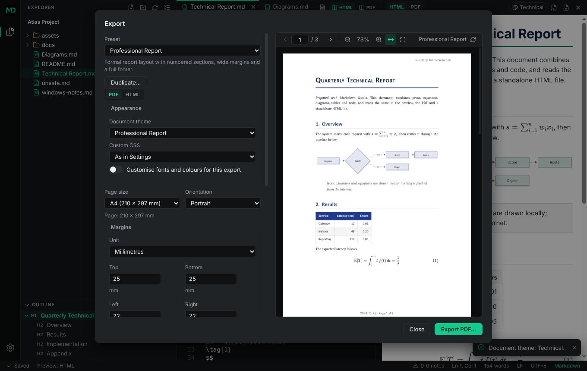
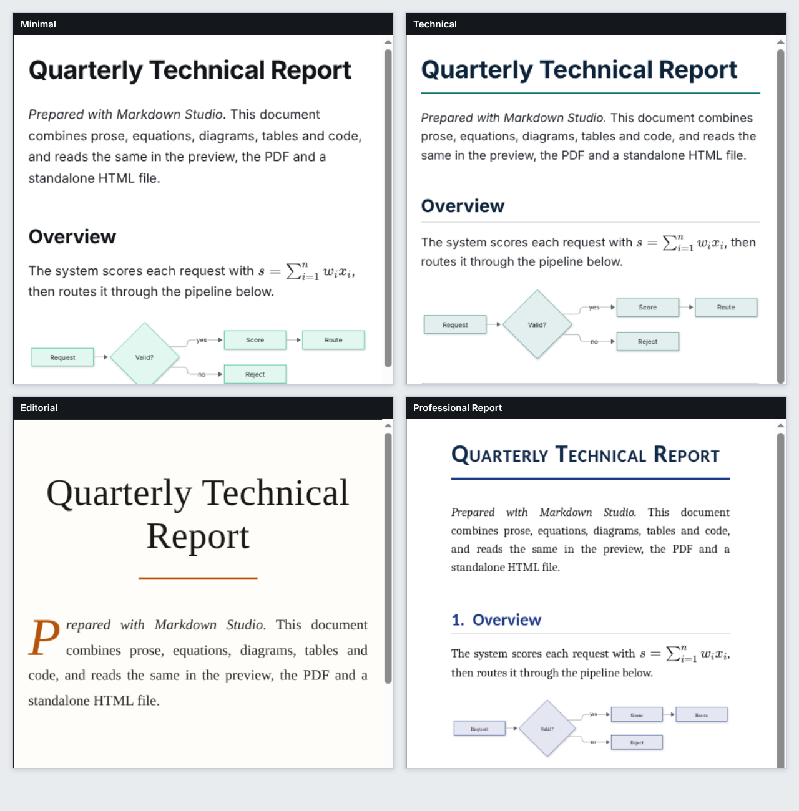

# Publishing guide: themes, page setup and export

This guide covers how documents look and how to publish them: document themes, custom CSS, PDF
page setup with headers and footers, standalone HTML, and export presets. The Markdown you write
is never changed by any of this; appearance and export settings live in the application's
settings, in the workspace's `.markdown-studio` folder, or in preset files — not in your document.



> **Level 2 update.** A document can now carry its own page, column, theme and numbering
> settings in its front matter (**Publish → Document Settings…**). They sit on top of the layers
> below for that document; see [Writing publications](PUBLICATIONS.md#document-settings-front-matter).

## Three layers of appearance

| Layer                         | Where you set it                                                      | Applies to                                                  |
| ----------------------------- | --------------------------------------------------------------------- | ----------------------------------------------------------- |
| **Application appearance**    | Settings → Appearance → Theme (dark / light)                          | Markdown Studio itself only                                 |
| **Document appearance**       | Settings → Appearance → Document appearance (global or per workspace) | Preview, PDF and HTML export                                |
| **Export-specific overrides** | The Export dialog (or a preset)                                       | That export (and the PDF preview while the setup is active) |

Later layers win: export overrides over workspace overrides over the application default. The
Settings page shows when a workspace override is active, and the preview header shows the
current theme (with a "Workspace" badge when the workspace chose it).

## Document themes

Four built-in themes, genuinely different in typography, headings, spacing, tables, quotes, code
and page composition:



| Theme                   | Character                                                                           |
| ----------------------- | ----------------------------------------------------------------------------------- |
| **Minimal**             | Clean sans-serif, restrained headings, horizontal table rules. For general notes.   |
| **Technical**           | Compact, ruled headings, full-grid tables, dark code blocks, boxed callouts.        |
| **Editorial**           | Serif body, centred title, drop cap, justified text, ornamental rules, quote marks. |
| **Professional Report** | Serif body with sans headings, numbered sections (1., 1.1), banded tables.          |

Choose one in **Settings → Appearance → Document appearance**, from the command palette (**Document Theme:
…**), the **View → Document Theme** menu, or per export in the Export dialog. Changing the theme
updates the preview in place: your editor focus, selection, scroll position and unsaved text are
untouched.

### Heading numbers

**Professional Report** numbers sections automatically: level-2 headings become 1., 2., 3. and level-3
headings 1.1, 1.2, … (the level-1 heading is the document title and is not numbered). The numbers are
generated when the document is displayed; they are not written into your Markdown. Other themes do not
number headings.

If you typed the numbers yourself, they are respected and **not added a second time**:

```markdown
## 1. Inleiding → 1. Inleiding (not "1. 1. Inleiding")

### 4.1 Vergelijkingstabel → 4.1 Vergelijkingstabel (not "4.1 4.1 …")
```

How it decides, deliberately conservatively:

- A level-2 heading counts as numbered when it starts with a number and a dot or bracket (`1.` or `2)`); a
  level-3 heading when it starts with a dotted number whose first part is the number of the section it sits
  in (`4.1` under section 4).
- A bare number is **not** an enumeration: `## 2024 Resultaten`, `## 3 Redenen` or `### 3.5 miljoen
gebruikers` under another section keep their automatic number, because the number belongs to the title. Numbers
  of more than three digits (years) are never treated as numbering.
- Headings without a typed number are numbered automatically, and counting continues from a typed number:
  after `## 1. Inleiding` an unnumbered heading becomes 2. If your own numbers skip or repeat, they are shown as
  you typed them.
- The same check applies to the **Number sections** option of Document Settings (front matter
  `number-sections: true`): a heading that already starts with the number that would be added is left as it is, in the
  text, the table of contents and cross-references. Headings marked `{.unnumbered}` never get a number.

The table of contents and `#heading` links use the heading text as written (`#4-resultaten-en-analyse`), so they
are the same with or without a typed number.

### Customising a theme

**Settings → Appearance → Document appearance → Fonts, colours and blocks** changes any of: body font and size,
heading font and scale, line height, paragraph spacing, content width, text, heading, link and
accent colours, the page background, and the style of tables, code blocks and block quotes. Empty
fields show the theme's own value. "Reset customisation" returns to the theme. Fonts are installed
system fonts with fallbacks (nothing is downloaded); "Custom family…" accepts any installed family
name.

A dark page background switches text, links, rules and diagrams to suitable colours.

### Global defaults and workspace overrides

Use the **Application default / This workspace** switch at the top of the section. Workspace
choices are stored in `<workspace>/.markdown-studio/presentation.json` (theme, customisation,
custom CSS, math and diagram switches) and apply only to that folder. **Clear override** removes
the file. Unchanged fields keep the application default.

## Custom CSS

Advanced users can add CSS **after** the theme: **Settings → Document Appearance → Custom CSS**,
either written in place or loaded from a `.css` file.

- It applies to rendered **documents only** (preview, PDF, HTML export). It can never style
  Markdown Studio's own interface, the Explorer, dialogs or the editor.
- It is validated with a real CSS parser before use. **Rejected CSS is not applied**, and the
  problems are listed with line numbers.
- Allowed: ordinary rules, `@media`, `@supports`, `@page`, `@font-face` (with `local()` or embedded
  `data:` fonts), `@keyframes`, `@layer`, `@container`, custom properties, `url(data:…)` images.
- Rejected: `@import` and `@namespace`; any `url()` that is not an embedded `data:` image or font
  (so no local files and no web addresses); `image-set()`, `image()`, `src()`, `expression()`,
  `behavior`, `-moz-binding`; escaped function or at-rule names; CSS larger than 256 KB.
- A CSS **file** is only read, never modified. When it changes in another program, the change is
  picked up when the window is focused again (a notice appears). Files must be inside the
  workspace or chosen with **Choose CSS File…**.
- Exported HTML includes the validated, normalised CSS as an inline `<style>`, so it stays
  self-contained and safe.

Example:

```css
h1 {
  letter-spacing: 0.02em;
}
blockquote {
  border-color: #0a7d5a;
}
@media print {
  h2 {
    break-before: page;
  }
}
```

## Math and diagrams

See the [mathematics guide](MATHEMATICS.md). Mermaid diagrams (` ```mermaid `) are drawn in an
isolated window, embedded as static SVG, and follow the theme (including dark pages). Settings →
Mathematical Notation and Diagrams switch each off without changing the Markdown.

## PDF export

Open **Export…** (`Ctrl+Shift+U`, the preview's export buttons, or **File → Export…**), choose
**PDF**, and adjust:

- **Page size:** A4, A5, US Letter, US Legal, or Custom (50–1200 mm) — in **portrait** or
  **landscape**.
- **Margins:** top, bottom, left, right, in millimetres, centimetres or inches. Values are stored
  in millimetres. Invalid values are refused with a message (for example margins that leave less
  than 30 mm of printable area).
- **Header and footer:** each can be switched on independently, with its own text and alignment.
  A header needs a top margin of at least 14 mm (at 9 pt) so it cannot overlap the text; the
  dialog says so and will not export until it is fixed.
- **More page options:** scale (50–200 %), header/footer size, printing of backgrounds and a page
  colour.

The preview on the right is the real PDF produced by the same print pipeline as the export.

### Placeholders

| Placeholder | Meaning                                                |
| ----------- | ------------------------------------------------------ |
| `{title}`   | Document title (its first heading, else the file name) |
| `{file}`    | File name                                              |
| `{date}`    | Date of export, `YYYY-MM-DD`                           |
| `{page}`    | Current page number                                    |
| `{pages}`   | Total number of pages                                  |

`Page {page} of {pages}` gives "Page 2 of 8". Page numbers come from the PDF engine's real
pagination, not an estimate. Everything you type is escaped (`<draft>` is shown literally). Write
`\{` for a literal brace.

### Page breaks and pagination

- A line containing only `<!-- pagebreak -->` starts a new page in the PDF (it is invisible in
  HTML). The command **Insert → Page Break** adds it.
- Headings are kept with the text that follows them where possible; code blocks wrap instead of
  being clipped; table header rows repeat on each page; images, diagrams and display equations are
  scaled to fit the printable area and are not split across pages.

Limits of the print engine (Chromium): very long unbreakable code lines wrap rather than scroll;
a single element taller than a page (for example a huge table row) is split by the engine where it
must; fonts are your system fonts at export time, so a PDF made on another computer may paginate
slightly differently if a font is missing.

### HTML and PDF are not identical

Both come from the same renderer, theme and settings, so content, numbering, tables, images, math and diagrams
match. They differ where paper differs from a screen: the PDF has pages, margins, headers, footers and real page
numbers and is paginated by Chromium's print engine; the HTML preview is one continuous page that adapts to its
window. `<!-- pagebreak -->` and the page background option only act in the PDF; wide tables shrink to the
printable width in the PDF (many columns can break long words). Fonts are your installed
system fonts, so a PDF produced on another computer can paginate slightly differently.

## Standalone HTML export

**Export → HTML** writes one file containing the rendered document, the theme, your validated
custom CSS, syntax-highlighting styles, Mermaid diagrams as inline SVG, KaTeX output with its
fonts embedded, local images embedded as data URIs (optional), working in-page heading links, and
a restrictive Content Security Policy. It needs no network and no JavaScript, text stays
selectable, and the layout is responsive.

Before writing, the file is audited for scripts, frames, event handlers, remote references and
unsafe URLs; an unsafe result is refused. After exporting you are told about limits a standalone
file cannot overcome — for example links to other Markdown files or images that stay as written
(`docs/guide.md`) and will not resolve once the file is moved, remote images that remain online,
or images that were not found.

## Export presets

A preset is a complete, validated publishing setup: format, theme, custom CSS choice, page size,
orientation, margins, header/footer, backgrounds and HTML options.

Built in: **Standard PDF**, **Technical Documentation**, **Professional Report**, **Compact
Notes**, **Standalone HTML**. In the Export dialog you can select a preset, adjust it for this
export, **Save changes**, **Duplicate…** / **Save as preset…**, **Rename…**, and **Delete…** (with
confirmation). Editing a built-in preset saves a modified copy; **Restore default…** (or
**Settings → Export Presets → Manage presets… → Restore built-in defaults**) brings the original
back.

Presets are stored as one JSON file each:

| Scope     | Location                                                |
| --------- | ------------------------------------------------------- |
| Global    | `export-presets/<id>.json` in the user-data folder      |
| Workspace | `<workspace>/.markdown-studio/export-presets/<id>.json` |

Unknown fields are ignored, damaged files are skipped (never rewritten), and files from newer
versions are read with the fields this version understands. The preset used last stays active for
the PDF preview; **Settings → Export Presets → Default preset** chooses it explicitly.

## Cancelling and failures

Export writes to a temporary file in the destination folder and renames it into place only when
the result is complete (PDFs are checked for structure). Cancelling, or a failure, leaves any
existing file exactly as it was; the dialog stays open with the reason so you can try again.
The save dialog asks before overwriting an existing file.

## Keyboard

`Ctrl+Shift+U` opens Export. Every dialog traps Tab, closes with Escape and returns focus to where
you were. Settings controls are reachable with Tab and arrow keys. All commands are in the command
palette (`Ctrl+Shift+P`): search "theme", "export", "equation", "diagram", "page break".
