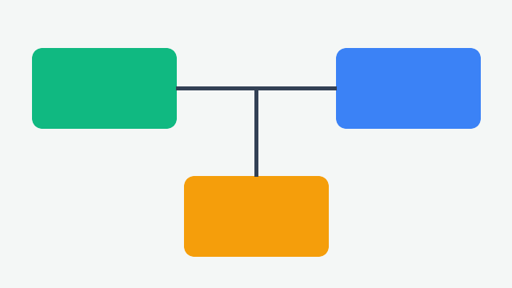

# Project Atlas

Project Atlas is a **sample documentation set** used to exercise Markdown Studio with
_realistic_ content: headings, tables, lists, code, images and inline HTML.

## Overview



The system has three services. See the [user guide](docs/guide.md) for setup steps and
the [roadmap](#roadmap) below. External reference: <https://commonmark.org>.

| Service   | Language   | Port |
|-----------|------------|-----:|
| Gateway   | TypeScript | 8080 |
| Indexer   | Rust       | 9000 |
| Reporting | Python     | 7000 |

## Getting started

1. Clone the repository.
2. Install dependencies:

   ```bash
   npm install
   npm run build
   ```

3. Start the gateway.

```ts
export function greet(name: string): string {
  return `Hello, ${name}!`
}
```

> **Note:** All services read configuration from `config/atlas.yaml`.

<div style="color: red; font-size: 24px;" id="inline-html">
  This is HTML inside Markdown.
</div>

## Roadmap

- [x] Gateway authentication
- [ ] Indexer sharding
- [ ] ~~Legacy exporter~~ replaced by Reporting

---

Made with Markdown Studio.
